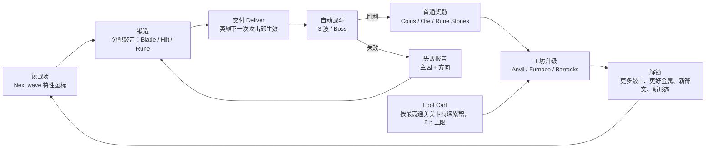

# 2. 核心循环与成长

## 2.1 循环总览

**[决定]** 长期循环：锻造 → 装备 → 自动战斗 → 获得材料 → 解锁新组合 → 挑战不同敌人。四个时间尺度如下。

## 2.2 10 秒循环：一次锻造

| 时间 | 玩家动作 | 系统反馈 | 规则来源 |
|---|---|---|---|
| 0–1 s | 看上半屏下一波的特性图标（如 Swarm） | 图标脉冲；架子上相应武器发光 `hint_suggested` | [5.9](05-combat.md#59-波次预告与推荐标签) |
| 1–2 s | 点 **Forge**，选符文（可不选） | 铁砧上出现烧红的坯料，显示可用敲击数 `forge_strikes_left` | [4.2](04-forge-system.md#42-开始条件) |
| 2–10 s | 在 Blade / Hilt / Rune 三个区域敲 6–14 下 | 每一下：火花、音效、震动；武器外形变化；右侧实时对比面板更新数值 | [4.4](04-forge-system.md#44-阶段与点击判定) |
| 10–11 s | 点 **Deliver** | 哥布林把武器抛给英雄（0.6 s）；英雄在下一个安全点换上 | [5.4](05-combat.md#54-武器何时装备何时生效能否战斗中替换) |
| 11–13 s | 看英雄出手 | 新形状的第一击：命中数字 `×4`，形状描边闪一次 | [8.6](08-ui-ux.md#86-一眼看懂这把武器改变了什么) |

节奏：敲得快慢不影响数值，只有踩中热光节拍会给 Temper（≤ +10% 伤害），见 [4.5](04-forge-system.md#45-节奏窗口与-temper)。

## 2.3 3 分钟循环：一次典型会话

| 分钟 | 内容 |
|---|---|
| 0:00–0:20 | 打开游戏 → **Welcome back** 面板领取 Loot Cart（可看 1 次广告翻倍，每日上限 2 次） |
| 0:20–0:50 | 用 Coins 升级 1 个工坊设施（通常每次会话 0–2 次） |
| 0:50–1:10 | 金属升级后重锻 1 把主力武器，或解锁新符文后锻 1 把新武器 |
| 1:10–2:40 | 推进 2–3 关（普通关 25–60 s，Boss 关 45–80 s，数据来自 [sim_output](../balance/sim_output.md#3-关卡验证期望状态每格-3-个随机种子)）。遇到失败 → 看失败报告 → 改锻或换装 → 重试 |
| 2:40–3:00 | 卡在下一关，或资源不足 → 离开；英雄留在 Farm 模式练习，Loot Cart 继续累积 |

**[决定]** 收益不取决于在线时长：Loot Cart 在线与离线的累积速率相同，“挂着不关”没有额外收益。玩家离开没有损失（8 小时上限以内）。

## 2.4 1 天循环

| 时段（示例） | 行为 | 驱动 |
|---|---|---|
| 早 08:00 | 领取一夜的 Cart（达到 8 h 上限）→ 2 次升级 → 推 2–4 关 | 一夜累积 |
| 午 12:30 | 领取约 4.5 h 的 Cart → 1 次升级 → 推 1–2 关 | Cart 未满 |
| 晚 19:00 | 领取约 6.5 h 的 Cart → 金属升级、全架重锻、挑战 Boss | 新金属、新 Boss |
| 睡前 23:00 | 看 Quick Loot 广告（每日 3 次）→ 最后一次升级 | 广告奖励 |

- 每天可累积的 Cart 时长：约 16 h（睡眠时段受 8 h 上限截断）。经济模型按每天 960 分钟换算，见 [7.5](07-economy.md#75-完整资源路径初始装备首次-boss第一次构筑转型)。
- P1 加入每日委托（Daily Commissions，每天 3 个，例如 “Clear 3 stages with a Greatsword”），用来引导玩家换着玩不同构筑。

## 2.5 30 天循环

| 天数 | MVP（P0）提供的内容 | P1 补充 | 玩家目标 |
|---|---|---|---|
| D1–D2 | 关卡 1–10（期望约第 1.4 天通关 10），Ember 与 Frost 符文，铁器时代 | — | 打败 Queen Mushla、Ironhide |
| D2–D3 | 关卡 11–15，Spark 符文，钢 | — | 打败 Thornwarden（Great 无效的 Boss） |
| D4–D7 | 关卡 16–20，Ironthorn Warden | 关卡 21–30（Rustfang Mines） | 集齐 Codex 12 种组合 |
| D8–D30 | P0 内容在约第 6 天推完（[7.5](07-economy.md#75-完整资源路径初始装备首次-boss第一次构筑转型)），之后只剩设施升级到 Lv10 | **Trial Tower**：程序生成楼层，每周轮换一个特性修饰，例如 “Armored Week: all enemies +50% Armor”；**Rune Altar**：用 Rune Stones 升级符文效果 | 每周换构筑打塔 |

**[决定]** 上表是完整 P0 的自然成长参考路径，不适用于 M0。M0 无等待/经济；1–10 关验证版只以 D1 和核心玩法指标决策，D7 记录为受内容限制的描述。完整 P0 的 D7 也必须先通过内容充足检查（[11.6](11-data-validation.md#116-继续调整停止的条件)）；不能将约第 6 天通完之后的退出直接解释为玩法失败。D30 依赖 P1。

## 2.6 主动点击、自动锻造、自动战斗、材料与长期成长的关系

| 环节 | 谁执行 | 输入 | 输出 | 不做什么 |
|---|---|---|---|---|
| 主动点击（锻造） | 玩家 | Ore（+ 可选 Rune Stone）、敲击预算 | 一把确定性的武器（形态、伤害、间隔、符文频率）+ Temper | 点击**不造成伤害**，点得快也不增加产出 |
| 自动锻造（Quick Forge） | 系统，Anvil Lv5 解锁 | 已保存的 Pattern + 同样的材料 | 同样分配的武器，Temper = 0 | 不替玩家选 Pattern；不自动换武器 |
| 自动战斗 | 系统 | 当前装备武器、英雄 HP、关卡配置 | 胜负、首通奖励、失败报告 | 不需要也不接受战斗输入（换武器除外，见 5.4） |
| 材料 | 系统发放 | 首通、Loot Cart、广告、内购 | Coins → 设施升级；Ore → 锻造；Rune Stones → 符文 | 击杀不掉落可累积资源，避免“刷怪越快越赚” |
| 长期成长 | 玩家决定花费方向 | Coins | 敲击预算 +1（Anvil）、金属基础伤害（Furnace）、英雄 HP（Barracks） | 不存在能跳过构筑选择的纯数值项，见 [6.4](06-gear-builds.md#64-稀有度与随机词条决定) |

## 2.7 解锁自动化后，玩家为什么还会手动锻造

1. **Temper**：手动踩中节拍每次 +1% 伤害，最多 +10%；Quick Forge 固定为 0。数值平衡以 Temper = 3 为基准（[4.5](04-forge-system.md#45-节奏窗口与-temper)），所以手动玩家比基准高约 7%，纯自动比基准低约 3%。在 Boss 关，这个差距足以决定胜负，但不会导致“不手动就过不去”。
2. **预算增加后，旧 Pattern 填不满**：每次 Anvil 升级会多 1 下敲击。Quick Forge 只复刻旧分配，多出的那一下要手动敲（或放弃），见 [4.8](04-forge-system.md#48-自动化quick-forge)。
3. **新敌人需要新分配**：新 Boss 和新特性组合会让旧 Pattern 失败（[6.3](06-gear-builds.md#63-构筑可用的打法)），只能先手动锻一次新的。
4. **Codex 首次奖励**：12 种形态×符文组合，每种第一次**手动**锻造奖励 20 Gems。
5. **手感本身**：敲击反馈（[8.7](08-ui-ux.md#87-音效与震动)）是核心体验。M1 试玩会测“解锁 Quick Forge 后手动锻造占比” **[待验证]**。

**[决定] 设计底线**：如果数据显示玩家解锁 Quick Forge 后几乎不再手动锻造，但**仍然在不同 Pattern 之间切换来应对敌人**，这是可以接受的结果，但还须用无提示迁移排除只跟随推荐的情况。核心假设验证的是“策略改变”，不是点击次数（[11.2](11-data-validation.md#112-核心验证玩家遇到困难时是否主动更换锻造策略)）。
