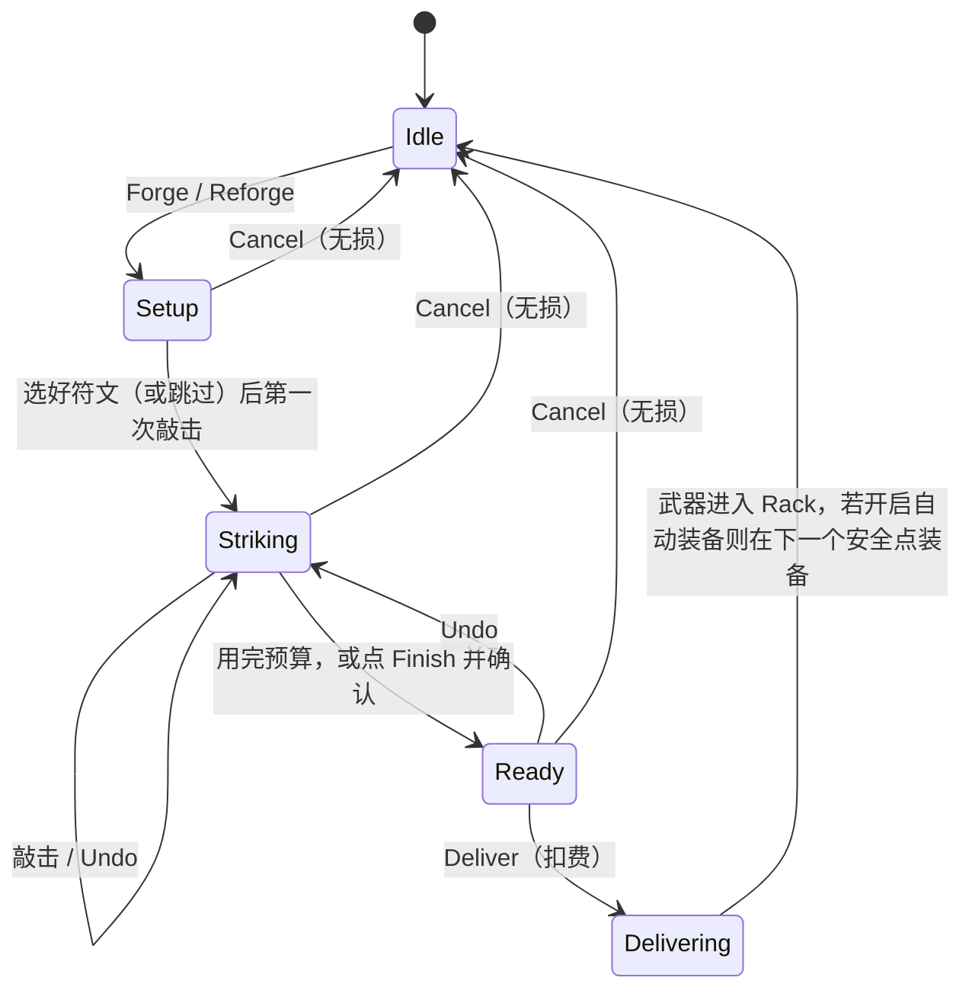

# 4. 锻造系统正式规格

> 所有数值均为**初始设计值**，与 `tools/balance_sim.py` 保持同步。取整规则：**四舍五入（half up）**记作 `rhu()`；攻击间隔保留 2 位小数；`ceil()` 为向上取整；`floor()` 为向下取整。

## 4.1 术语

| 术语 | 英文（玩家可见） | 定义 |
|---|---|---|
| 锻造预算 | Strikes | 一次锻造可敲的次数 B，由 Anvil 等级决定 |
| 区域 | Blade / Hilt / Rune | 铁砧上 3 个可敲区域，每敲 1 次加 1 点 |
| 点数 | — | Bp（剑刃）、Hp（剑柄）、Rp（符文）；Bp + Hp + Rp ≤ B |
| 形态 | Needle / Broad / Great | 由 Bp 区间决定的攻击形状，见 4.6 |
| 金属基础伤害 | — | MD，由**锻造时**的 Furnace 等级决定，写入武器后不再变化 |
| Temper | Temper | 本次锻造的 Perfect 次数，每点 +1% 伤害，上限 10 |
| 每击伤害 | Damage | H，护甲结算前的单次命中伤害 |
| 攻击间隔 | Swing | I，两次攻击之间的秒数 |
| 符文频率 | Rune: every N swings | 每 N 次挥砍触发一次符文 |
| 武器架 | Rack | 持有武器的槽位，3 → 4（通关 8）→ 5（通关 15） |

## 4.2 开始条件

| 项 | 规则 |
|---|---|
| 入口 | 下半屏空闲状态下的 **Forge** 按钮（`btn_forge`）；或武器详情页的 **Reforge**（`btn_reforge`） |
| 必要条件 | ① Ore ≥ 当前 Furnace 等级的锻造成本（见 4.3）；② 武器架有空位，**或**玩家接受交付时熔炼一把（交付时弹出选择） |
| 可选条件 | 加符文需要：Rune Stones ≥ 1 **且** 至少解锁 1 种元素（Ember 通关 5 解锁，Frost 通关 10 解锁，Spark 通关 12 解锁） |
| 不需要 | 不需要暂停战斗；没有时间限制；没有体力 |
| 不满足时 | Ore 不足：按钮置灰并显示 `err_not_enough_ore` “Not enough ore”，点击后打开 Loot Cart 说明（不弹商店）。无空位：允许开始，交付时要求熔炼 |
| 并发 | 同一时间只能有 1 个锻造会话（不设锻造队列，原因见 [9.3 #3](09-monetization.md#93-候选商品逐项规格)） |

## 4.3 材料与成本

| 操作 | Ore | Rune Stone | Coins | 说明 |
|---|---|---|---|---|
| 新锻造（不带符文） | `FURNACE_ORE[Furnace 等级]`（Lv1–10：6 / 8 / 10 / 15 / 18 / 22 / 32 / 38 / 45 / 65） | 0 | 0 | — |
| 新锻造（带符文） | 同上 | 1 | 0 | 交付时扣除，取消不扣 |
| 重铸 Reforge（保持同一元素或无符文） | 新成本 − floor(0.8 × 旧武器所付 Ore) | 0（原符文石保留） | 0 | 原武器在交付时消失 |
| 重铸并更换/新增元素 | 同上 | 1（旧符文石销毁） | 0 | 交付前明确提示 `reforge_stone_warn` |
| 熔炼 Smelt | +floor(0.8 × 所付 Ore) | 不返还 | 0 | 武器上锁时禁止熔炼 |

**扣费时机 [决定]**：所有消耗在 **Deliver** 的一瞬间结算。之前任何时刻点 **Cancel** 都完全无损。

## 4.4 阶段与点击判定

### 4.4.1 状态机

### 4.4.2 各阶段规则

| 阶段 | 输入 | 处理 | 输出 | 限制 / 异常 |
|---|---|---|---|---|
| Setup | 符文选择条：No Rune / Ember / Frost / Spark（未解锁的隐藏，没有符文石的置灰并显示 `err_no_rune_stones`） | 选择一种元素后，Rune 区域可敲 | 会话记录 rune_element | 第一次敲击后元素锁定，要改元素只能 **Reset**（清空全部敲击） |
| Striking | 在 3 个区域的点击 | 判定见 4.4.3。每次有效敲击：对应点数 +1，剩余预算 −1，播放打击反馈，判定节拍（4.5），刷新预览 | 实时预览面板 | 区域达到上限：本次点击无效，不消耗预算，显示 `forge_zone_max` “Max”，轻震动 |
| Ready | 预算用完，或点 **Finish**（`btn_finish`）且剩余 > 0 | 剩余 > 0 时弹出确认 `forge_unused_confirm` “{count} strikes unused. Finish anyway?” | — | 未用完的敲击作废，不保留到下次 |
| Delivering | **Deliver**（`btn_deliver`） | 扣费 → 生成武器（4.12）→ 抛给英雄的动画（0.6 s）→ 进入 Rack | 武器对象 | 武器架满时先弹出熔炼选择；放弃熔炼则回到 Ready |

### 4.4.3 点击判定

| 规则 | 值 | 说明 |
|---|---|---|
| 有效区域 | Blade：武器上部 45%；Rune：护手附近 30%；Hilt：下部 25% | 每个区域的触控热区 ≥ 64×64 pt，区域之间留 8 pt 死区 |
| 死区与区域外点击 | 无效，不消耗预算，无反馈 | 防误触 |
| 最小有效间隔 | 0.15 s | 相邻两次有效敲击至少间隔 0.15 s；更快的点击静默丢弃，不惩罚 |
| 多指 | 只认第一根手指 | 其他触点忽略 |
| Undo | `btn_undo`：撤销最后一次敲击，返还 1 下预算，同时撤销它带来的 Temper | 次数不限；只有 Striking / Ready 阶段可用 |
| Reset | `btn_reset`：清空本次所有敲击与 Temper | 需要确认 `forge_reset_confirm` |
| 长按 | 无功能（避免误判） | — |

**[决定] 点击速度不影响收益。** 预算固定，敲 10 下用 2 秒还是 20 秒结果相同。唯一与时机有关的是 Temper（4.5），它只看节拍，不看速度。

## 4.5 节奏窗口与 Temper

| 项 | 规则（初始设计值） |
|---|---|
| 节拍 | 坯料每 0.80 s 发一次热光脉冲（白热光圈从外向内收缩，到达区域轮廓时最亮） |
| Perfect 窗口 | 脉冲峰值 ±100 ms；**Relaxed** 模式下为 ±180 ms |
| Perfect 奖励 | Temper +1，金色火花，`forge_perfect` “Perfect!”，强震动 |
| 普通敲击 | 窗口外的敲击记为 Good：正常加点，无 Temper，普通火花，不显示文字 |
| 失误后果 | **没有**。不扣分、不扣预算、不会锻坏 |
| Temper 上限 | min(10, 本次有效敲击数) |
| Temper 效果 | 每点 +1% 每击伤害（公式见 4.6） |
| 平衡基准 | 关卡平衡按 Temper = 3 计算（`TEMPER_BASELINE`） |
| 设置项 | `settings_rhythm`：**On**（默认）/ **Relaxed** / **Off**。Off 时不显示光圈，Temper 固定为 3（等于基准），保证节奏感弱的玩家不吃亏 |
| Quick Forge | Temper 固定为 0（4.8） |

**新手不会反复失败的保证**：①错过节拍没有惩罚；②Off 模式等于平衡基准；③前 7 关在 Temper 0 与 2 下胜负相同（[3.4](03-first-10-minutes.md#34-分支与异常)）。

## 4.6 区域如何改变属性（正式公式）

### 4.6.1 区域职责（收敛后的规则）

| 区域 | 唯一职责 | 副作用（取舍来源） | 上限 |
|---|---|---|---|
| **Blade 剑刃** | ①每点 +10% 伤害；②点数跨过阈值时改变**形态**（攻击形状） | 形态越宽，基础间隔越长（越重） | 12 |
| **Hilt 剑柄** | 每点让攻击间隔缩短“形态基础间隔的 7%” | 不加伤害 | 6 |
| **Rune 符文** | 每点让符文触发更频繁：每 N = 6 − Rp 次挥砍触发一次 | 不加伤害、不加速；必须先选元素 | 5 |

> 收敛说明：候选规则中的“重量”并入 Blade 的形态基础间隔，“稳定性 / 操作效率”被删除（没有可读的战斗表现），“特殊技能”收敛为 3 种符文触发效果。每个区域只负责 1 个可见维度：形状、节奏、触发。

### 4.6.2 形态表

| 形态（英文名） | Bp 区间 | 形态倍率 M | 基础间隔 I₀（s） | 攻击形状 | 范围（u） | 最多目标 | 前摇占比 |
|---|---|---|---|---|---|---|---|
| **Needle**（刺剑） | 0–3 | 1.00 | 1.00 | 单体刺击（最近的敌人） | 1.6 | 1 | 35% |
| **Broad**（宽刃剑 *Broadsword*） | 4–7 | 0.90 | 1.35 | 朝主目标方向的 150° 扇形 | 2.0 | 6 | 35% |
| **Great**（巨刃剑 *Greatsword*） | 8–12 | 1.40 | 2.30 | 以英雄为中心 360° 环斩 | 2.4 | 10 | 35%（上限 0.60 s） |

1u = 32 pt（战场宽 12u）；范围从英雄碰撞圆边缘（半径 0.5u）量到敌人碰撞圆边缘。

### 4.6.3 公式

| 量 | 公式 | 变量与单位 |
|---|---|---|
| 每击伤害 H | `H = rhu(MD × (1 + 0.10 × Bp) × M × (1 + 0.01 × T))` | MD：金属基础伤害（点）；Bp：剑刃点数；M：形态倍率；T：Temper（0–10）；H：点 |
| 攻击间隔 I | `I = round(I₀ × (1 − 0.07 × Hp), 2)` | I₀：形态基础间隔（s）；Hp：剑柄点数（0–6）；I：s |
| 前摇 W | `W = round(clamp(0.35 × I, 0.15, 0.60), 2)` | s；命中帧在前摇结束时 |
| 符文频率 N | `N = 6 − Rp`（Rp = 1…5 → N = 5…1） | 每 N 次挥砍触发一次 |
| Ember 灼烧（每跳） | `ceil(1.5 × H / 3)`，每秒 1 跳，共 3 跳 | 共 150% H，无视护甲与护盾 |
| Frost 冰霜 | 触发那一击的原始伤害 × 1.3；被命中的目标获得 Chill 3.5 s：攻击、移动、召唤与重击计时 ×0.65 速度 | — |
| Spark 电击 | 主目标 + 主目标 3u 内最近的至多 2 个敌人，各受 `0.6 × H` 原始伤害；**贯穿 Guard**（打掉 1 颗护盾点并照常造成伤害） | 护甲照常结算 |
| 单目标 DPS（参考） | `H_after_armor / I + 灼烧 DPS` | 点/s；只用于设计对比，不在游戏内显示 |

金属表（Furnace）：MD = 10 / 12 / 14 / 17 / 20 / 24 / 28 / 33 / 39 / 46（Lv1–10）。Lv1–3 为 Copper，4–6 为 Iron，7–9 为 Steel，10 为 Moonsilver。

## 4.7 属性之间的成本与取舍

### 4.7.1 同一预算的三种分配（MD 20、预算 10、Temper 3）

| 构筑 | H | 间隔 s | 无甲单体 DPS | 甲 12 单体 DPS | 甲 20 单体 DPS | 打破 3 颗护盾 | 一次覆盖 |
|---|---|---|---|---|---|---|---|
| Needle B3/H6（剩 1 下用不掉） | 27 | 0.58 | **46.6** | 25.9 | 12.1 | 3 次挥砍 | 1 |
| Broad B4/H6 | 26 | 0.78 | 33.3 | 17.9 | 7.7 | 3 次挥砍 | ≤ 6（扇形） |
| Great B8/H2 | 52 | 1.98 | 26.3 | 20.2 | **16.2** | **永远打不破**（间隔 > 1.5 s，护盾会回复） | ≤ 10（360°） |
| Needle + Ember B3/H4/R3 | 27 | 0.72 | **51.5** | **34.8** | **23.7** | 3 次挥砍 | 1（灼烧只作用于被命中的目标） |
| Broad + Spark B4/H3/R3 | 26 | 1.07 | 24.3 | 13.1 | 5.6 | 3 次挥砍，电击还能顺带打掉相邻敌人的护盾 | ≤ 6 + 2 道电弧 |
| Great + Frost B8/H1/R1 | 52 | 2.14 | 24.3 | 18.7 | 15.0 | 永远打不破 | ≤ 10，且全体减速 |

数据来源：`python tools/balance_sim.py matrix`。

### 4.7.2 取舍规则

1. **覆盖面 vs 单体速度**：每 1 点从 Hilt 挪到 Blade，伤害 +10%，但间隔变长 7% × I₀。Bp 跨过 4 或 8 时，形态倍率和基础间隔会跳变，此时单体 DPS **下降**、覆盖面**上升**：Needle → Broad 单体 DPS −29%，Great 又比 Broad 再降约 20%。
2. **单击重量 vs 次数**：护甲按次扣减（[5.5](05-combat.md#55-伤害公式与单位)），所以甲越厚，越偏向 Great（单击 52）或 Ember（灼烧无视护甲）；Guard 按次阻挡，所以护盾越多，越偏向快速挥砍或 Spark。这两种需求互相冲突，**没有一种分配能同时最优**。
3. **符文 vs 剑柄**：Rp 和 Hp 共用剩余预算。打无甲单体时，Hp 的收益约等于 Rp（46.6 vs 51.5）；但对甲 20 的目标，Rp 的收益是 Hp 的约 2 倍（23.7 vs 12.1）。符文是“解特定问题”的点数，不是通用强化。
4. **预算溢出**：不带符文的 Needle 最多只能用 3 + 6 = 9 下。预算超过 9 后，Needle 必须带符文才能不浪费，这把 Needle 推向“符文引擎”的定位。
5. **稀有度不存在**：同金属、同分配的两把武器完全一样（Temper 差 ≤ 10%），见 [6.4](06-gear-builds.md#64-稀有度与随机词条决定)。

## 4.8 自动化：Quick Forge

| 项 | 规则 |
|---|---|
| 解锁 | Anvil Lv5（期望进度约在关卡 10，第 1–2 天） |
| Pattern | 在武器详情页点 **Save Pattern**（`btn_save_pattern`）保存它的（Bp, Hp, Rp, 元素）。默认 3 个槽位，Anvil Lv10 时变为 4 个 |
| 执行 | 锻造界面点 **Quick Forge**（`btn_quick_forge`）→ 选 Pattern → 系统用 1.0 s 自动敲完 → 进入 Ready |
| 成本 | 与手动完全相同（Ore、Rune Stone） |
| Temper | 固定 0 |
| 预算不一致 | 当前预算 > Pattern 总点数：多出的敲击留给玩家手动敲，或 Finish 作废（显示 `qf_leftover`，单数 “{count} strike left. Tap to use it.”，复数 “{count} strikes left. Tap to use them.”）。当前预算 < Pattern 总点数（理论上不会发生，因为预算只增不减）：按 Blade → Hilt → Rune 的顺序截断 |
| 元素不可用 | Pattern 带符文但 Rune Stones = 0：Quick Forge 置灰，显示 `err_no_rune_stones` |
| 不做的 | 不自动选择 Pattern；不在离线时锻造；不自动换武器 |

## 4.9 锻造算例

> 全部可复算：`python tools/balance_sim.py weapons`。

### 算例 E1：教程第一把武器

- **输入**：Furnace Lv1（MD 10，Ore 成本 6），教程固定预算 4，无符文。敲击顺序 H, H, B, B，其中第 3 下 Perfect（T = 1）。
- **处理**：Bp = 2 → Needle（M 1.00，I₀ 1.00）。H = rhu(10 × 1.2 × 1.00 × 1.01) = rhu(12.12) = **12**。I = round(1.00 × (1 − 0.14), 2) = **0.86 s**。W = round(0.301, 2) = 0.30 s。
- **输出**：*Copper Needle*，每击 12，间隔 0.86 s，单体 DPS 14.0。Ore 20 → 14。

### 算例 E2：教程第二把武器（第一次形态跳变）

- **输入**：MD 10，预算 7（Anvil Lv2），无符文。B ×4（第 4 下触发 **Broad!** 变形），H ×3，T = 2。
- **处理**：Bp = 4 → Broad（M 0.90，I₀ 1.35）。H = rhu(10 × 1.4 × 0.90 × 1.02) = rhu(12.852) = **13**。I = round(1.35 × 0.79, 2) = **1.07 s**。W = 0.37 s。150° 扇形，最多 6 个目标。
- **输出**：单体 DPS 12.1（比 E1 的 14.0 低 14%），但在关卡 3 第 2 波平均每次挥砍命中 2.9 个目标，有效 DPS ≈ 35。
- **对照**：如果改成 B3/H4（仍是 Needle），H = rhu(10 × 1.3 × 1.02) = 13，I = 0.72，单体 DPS 18.1 更高，但关卡 3 会失败（模拟 0/3）。这就是“形状比数值重要”的第一课。

### 算例 E3：第一把符文武器

- **输入**：MD 12（Furnace Lv2），预算 7，选 Ember。B ×3、H ×1、R ×3，T = 2。消耗 8 Ore + 1 Rune Stone。
- **处理**：Needle。H = rhu(12 × 1.3 × 1.02) = rhu(15.912) = **16**。I = round(1.0 × 0.93, 2) = **0.93 s**。N = 6 − 3 = **3**。灼烧每跳 = ceil(1.5 × 16 / 3) = **8**，3 跳共 24。
- **对甲壳虫（关卡 6，Armor 10）**：物理每击 = max(16 − 10, ceil(16 × 0.2)) = **6**；每 3 次挥砍（2.79 s）刷新一次灼烧，灼烧持续 3 s，覆盖率 100%，即每秒 8。单体 DPS = 6 / 0.93 + 8 = **14.5**。对照无符文 Broad：max(13 − 10, 3) / 1.07 = **2.8**。

### 算例 E4：第一把巨刃剑

- **输入**：MD 12，预算 8（Anvil Lv3），B ×8，T = 3。武器架已满，熔炼 E1（返还 floor(6 × 0.8) = 4 Ore）。
- **处理**：Bp = 8 → Great（M 1.40，I₀ 2.30）。H = rhu(12 × 1.8 × 1.40 × 1.03) = rhu(31.147) = **31**。I = **2.30 s**（Hp = 0）。W = min(0.60, 0.805) = **0.60 s**。
- **输出**：360° 环斩，对 Armor 10 每击 21。关卡 7 模拟 5/5 胜，剩余 HP 78%；同关 Broad 0/5 胜。Ore 44 − 8 + 4 = 40。

### 算例 E5：Ironhide 的答案

- **输入**：MD 20（Furnace Lv5），预算 10（Anvil Lv5），Ember。B3 / H4 / R3，T = 5。
- **处理**：H = rhu(20 × 1.3 × 1.05) = rhu(27.3) = **27**。I = **0.72 s**。N = 3（每 2.16 s 刷新灼烧）。灼烧每跳 = ceil(40.5 / 3) = **14**。
- **对 Ironhide（Armor 20，HP 500）**：物理每击 = max(27 − 20, ceil(5.4)) = 7 → 9.7 DPS；灼烧 14 DPS；合计 23.7 DPS，纯输出约 21 s。模拟整场 Boss 战（含走位、重击）约 32 s，剩余 HP 34%。
- **Temper 对比**：T = 0 时 H = 26；T = 10 时 H = rhu(28.6) = 29。手动满 Temper 比 Quick Forge 高 11.5%。

### 算例 E6：Quick Forge 复刻（Temper 0）

- **输入**：Pattern “Needle + Spark” = B3 / H5 / R3，Furnace Lv7（MD 28，Ore 32），预算 11（Anvil Lv6），Quick Forge。
- **处理**：自动敲 11 下，T = 0。H = rhu(28 × 1.3) = rhu(36.4) = **36**。I = round(1.0 × 0.65, 2) = **0.65 s**。N = 3。电击每道原始伤害 = rhu(0.6 × 36) = **22**。
- **对 Thornwarden（Guard 6，护盾不被打 1.2 s 后开始回复）**：挥砍间隔 0.65 s < 1.2 s，护盾持续被压制；每次电击打掉 1 颗护盾并造成 22 点伤害。整关模拟 3/3 胜（Boss 段约 25 s），剩余 HP 70%。

### 算例 E7：预算用不完（边界）

- **输入**：MD 24（Furnace Lv6），预算 11，没有符文石。玩家想要 Needle：B3 / H6。
- **处理**：Hilt 达到上限 6 后再点无效（`forge_zone_max`）。Blade 第 4 下会让形态变成 Broad，此时预览闪烁警告 `forge_form_change_warn` “This will turn it into a Broadsword.”。玩家点 **Finish** → 确认 `forge_unused_confirm`（剩 2 下）。
- **输出**：H = rhu(24 × 1.3 × 1.04) = rhu(32.448) = **32**（T = 4），I = **0.58 s**，有 2 下预算作废。
- **设计含义**：提示玩家“Needle 想吃满预算就带符文”，见 4.7.2 第 4 条。

## 4.10 中断、重铸、替换、材料不足与离线

| 情况 | 处理 |
|---|---|
| 锻造中切到后台 | 节拍暂停；会话（元素、Bp/Hp/Rp、Temper、已敲顺序）立刻写入存档。回到前台后继续，第一个节拍在 0.8 s 后开始 |
| 锻造中 App 被杀或崩溃 | 存档中的 `forge_session` 每次有效敲击后 1 s 内落盘（节流），恢复后回到 Striking，最多丢失最后 1 s 内的敲击 |
| 锻造中英雄战败 | 锻造不受影响，继续进行；上半屏单独显示失败报告 |
| 锻造中关卡切换或进入 Boss Gate | 不影响锻造 |
| 重铸 Reforge | 从武器详情页进入。新会话使用**当前** Furnace 金属与**当前**预算，敲击从 0 开始（不预填，避免和 Quick Forge 重复）。成本见 4.3。交付时旧武器被替换，同一槽位保留，装备状态继承 |
| 替换（武器架满） | 交付前弹出熔炼选择（`rack_full_pick`），列出所有未上锁的武器及返还 Ore。全部上锁时提示 `rack_all_locked` 并回到 Ready |
| 材料不足 | Ore 不足：Forge 与 Quick Forge 置灰（4.2）。Rune Stones 不足：符文选项置灰，可继续锻无符文武器 |
| 锻造会话期间 Ore 变化 | 成本在 Deliver 时校验；此时如果 Ore 不足（理论上只有被外部消耗才会发生），提示 `err_not_enough_ore` 并保留会话 |
| 离线 | 离线不能锻造，也不能 Quick Forge；未完成的会话保留，无过期时间 |
| 配置更新改变公式参数 | 已生成的武器保留生成时写入的 H / I / N（4.12），不回溯重算；新参数只影响之后的锻造。例外：发生 Bug 级错误时，用 `weapon_recalc_version` 强制重算，并补偿差额 |

## 4.11 连点器与操作能力差异

| 风险 | 处理 | 理由 |
|---|---|---|
| 连点器提高产出 | 预算固定，最小间隔 0.15 s，速度不影响结果 | 连点器只能省时间，不能多拿资源 |
| 连点器刷 Perfect | 固定频率的连点器落在 ±100 ms 窗口内的概率约为 200 / 800 = 25%（预算 10 时平均 T ≈ 2.5，低于基准 3）；能对准节拍的脚本最多拿到 +10% | 单机游戏、无排行榜，收益上限 10% |
| 刷关卡资源 | 击杀不掉落可累积资源；Loot Cart 按时间累积，与击杀速度无关；首通奖励只发一次 | [7.6](07-economy.md#76-平衡检查指数膨胀无限刷取材料死锁付费加速) |
| 节奏感弱 / 单手不便 | Relaxed（±180 ms）与 Off（固定 T = 3） | 等于平衡基准，不吃亏 |
| 视觉障碍 / 色弱 | 区域同时用形状 + 文字标注（Blade / Hilt / Rune），节拍有震动提示 | [8.7](08-ui-ux.md#87-音效与震动) |

## 4.12 输出：武器数据

| 字段 | 类型 | 说明 |
|---|---|---|
| weapon_id | string（UUID） | — |
| name | string | `{metal} {formNoun}`，例如 “Iron Broadsword”，≤ 21 字符，见 [strings](strings.md#武器与材料) |
| metal_level / md | int | 锻造时的 Furnace 等级与 MD |
| bp / hp / rp | int | 点数 |
| rune | enum | none / ember / frost / spark |
| temper | int | 0–10 |
| form | enum | needle / broad / great |
| hit_damage / interval / windup / rune_every | int / float / float / int | 生成时计算并写入 |
| ore_paid | int | 用于计算熔炼与重铸返还 |
| locked | bool | 上锁后不能熔炼 |
| source | enum | manual / quick_forge / tutorial |
| created_at | int（unix s） | — |
| calc_version | int | 公式版本号 |
