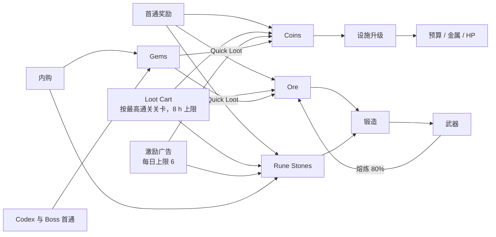

# 7. 经济与进度

> **本章所有数字都是初始设计值。** 计算与复算：`python tools/balance_sim.py economy` / `tables`，输出快照见 [sim_output §4–5](../balance/sim_output.md)。经济模型把“每天可累积的 Loot Cart 时长”取为 960 分钟（16 h）。

## 7.1 资源清单

**[决定] MVP 只有 4 种资源。**

| 资源（英文名） | 类型 | 来源 | 消耗 | 上限 | 备注 |
|---|---|---|---|---|---|
| **Coins** | 软货币 | 首通奖励；Loot Cart；Quick Loot（广告或宝石）；Forge Supply Box（内购，可选） | 设施升级（Anvil / Furnace / Barracks） | 无玩法上限（存储上限 2³¹−1，显示 1.2K / 3.4M） | 唯一的升级货币 |
| **Ore** | 材料 | 首通奖励；Loot Cart；熔炼与重铸返还 80%；Supply Box | 锻造与重铸 | 无玩法上限 | 只用于锻造；成本随 Furnace 等级上升 |
| **Rune Stones** | 材料（通用，不分元素） | 首通关卡 5 / 8 / 10 / 12 / 15 / 20；Loot Cart 每累积 360 分钟 +1（通关 5 之后）；每日广告 1 颗；首购与 Supply Box | 新锻带符文武器、重铸时更换或新增元素 | **20** | 超出部分在发放时自动换成 Coins：每颗 = 30 × 当前 Cart 每分钟 Coins（向下取整），提示 `stone_overflow` |
| **Gems** | 高级货币 | 内购；Codex 每格首次 +20（共 240）；Boss 首通 +30（4 个 Boss 共 120） | Quick Loot（50 Gems，每日 3 次）；外观（P1）；Supply Box 的宝石版本（P1） | 无 | 不能购买强度道具 |

**不新增的资源（及理由）**：没有体力（不限制挑战次数）、没有英雄经验（成长全部在设施上）、没有分元素符文石（降低理解成本，同时让“选哪种元素”成为决策而不是库存问题）、没有锻造“锤子能量”（锻造不应被时间门限卡住）。

## 7.2 资源流

## 7.3 前 10 级锻造设施

**[决定]** 升级立即生效，**不设建造计时**，所以不存在“付费跳过计时”。升级费用公式：Lv2 = 基数；Lv ≥ 3 时 `cost(L) = round(基数 × 增长^(L−2), −1)`。Anvil 基数 40、增长 2.7；Furnace 基数 60、增长 2.6；Barracks 基数 50、增长 2.6。

| 等级 | **Anvil** 预算（下） | Anvil 费用 | **Furnace** 金属 | MD | 每次锻造 Ore | Furnace 费用 | **Barracks** 英雄 HP | Barracks 费用 |
|---|---|---|---|---|---|---|---|---|
| 1 | 6 | — | Copper | 10 | 6 | — | 100 | — |
| 2 | 7 | 40 | Copper | 12 | 8 | 60 | 118 | 50 |
| 3 | 8（可锻 Great）· 需通关 6 | 110 | Copper | 14 | 10 | 160 | 139 | 130 |
| 4 | 9 | 290 | **Iron** · 需通关 5 | 17 | 15 | 410 | 164 | 340 |
| 5 | 10 · 解锁 Quick Forge | 790 | Iron | 20 | 18 | 1,050 | 194 | 880 |
| 6 | 11 | 2,130 | Iron | 24 | 22 | 2,740 | 229 | 2,280 |
| 7 | 12 | 5,740 | **Steel** · 需通关 10 | 28 | 32 | 7,130 | 270 | 5,940 |
| 8 | 13 | 15,500 | Steel | 33 | 38 | 18,530 | 319 | 15,450 |
| 9 | 14 | 41,840 | Steel | 39 | 45 | 48,190 | 376 | 40,160 |
| 10 | 14 · Pattern 槽 +1 | 112,970 | **Moonsilver** · 需通关 20 | 46 | 65 | 125,300 | 444 | 104,410 |
| 累计到 Lv10 | — | 179,410 | — | — | — | 203,570 | — | 169,640 |

- Furnace 只影响**之后锻造**的武器（金属写入武器），所以每次金属升级都会带来一次重锻。这是锻造频率的主要来源之一。
- 升级界面显示升级后的效果，例如 `upgrade_anvil_effect` “Strikes {from} → {to}”；被关卡门槛锁住时显示 `upgrade_locked_stage` “Clear Stage {stage} to unlock”。

## 7.4 前 20 关示例进度与材料需求

> 波次写法：M = Mushling，S = Bramble Sprite，Sh = Shellback；“×n”为数量；括号内为出现方向。期望状态 = 设计时假定玩家通关这一关时的设施等级（Anvil / Furnace / Barracks）。

| 关卡 | 区域 | 第 1 波 | 第 2 波 | 第 3 波 | 主要考点 | 期望 A/F/B | 推荐构筑（模拟最佳） | 首通 Coins / Ore / Stones | 解锁 | 通关后 Cart 每分钟 Coins / Ore |
|---|---|---|---|---|---|---|---|---|---|---|
| 1 | Mossy Hollow | M×2 (R) | M×3 | M×3 | 教学 | 1/1/1 | Needle 或 Broad | 30 / 6 / 0 | — | 4.00 / 0.025 |
| 2 | Mossy Hollow | M×3 | M×4 | M×4 | 教学 | 1/1/1 | Needle 或 Broad | 34 / 6 / 0 | — | 4.40 / 0.027 |
| 3 | Mossy Hollow | M×3 | **M×10（左右各 5）** | M×5 | Swarm | 2/1/1 | **Broad**（Needle 0/3） | 38 / 7 / 0 | — | 4.84 / 0.028 |
| 4 | Mossy Hollow | M×4 | S×2 (T) | M×3 + S×2 | Guard 入门 | 2/2/1 | Broad | 43 / 8 / 0 | — | 5.32 / 0.030 |
| **5** | Mossy Hollow | M×4 | S×2 + M×3 | **Queen Mushla** | Swarm Boss | 2/2/1 | **Broad** | 147 / 8 / 2 | **Ember**；Furnace Lv4；+30 Gems | 5.86 / 0.032 |
| 6 | Mossy Hollow | M×4 | Sh×1 + M×3 | **Sh×2** | Armor 入门 | 2/2/2 | **Needle + Ember** | 55 / 9 / 0 | Anvil Lv3 | 6.44 / 0.033 |
| 7 | Mossy Hollow | Sh×2 | M×7 | Sh×1 + M×4 | Swarm + Armor | 3/2/2 | **Great** | 62 / 10 / 0 | Loot Cart 上线 | 7.09 / 0.035 |
| 8 | Mossy Hollow | **S×3** | Sh×1 + S×2 | M×8 | Guard（Great 0/3） | 4/4/3 | Broad | 71 / 10 / 1 | 武器架 4 格 | 7.79 / 0.038 |
| 9 | Mossy Hollow | M×7 | Sh×2 | S×3 + Sh×1 | 混合 | 4/5/3 | Broad + Ember | 80 / 11 / 0 | — | 8.57 / 0.040 |
| **10** | Mossy Hollow | Sh×2 + M×3 | S×3 | **Ironhide** | Armor Boss | 5/5/4 | **Needle + Ember** / Great | 270 / 12 / 2 | **Frost**；Furnace Lv7；+30 Gems | 9.43 / 0.042 |
| 11 | Bramble Deep | S×4 | M×8 | S×3 + M×4 | Guard + Swarm | 5/5/4 | Broad | 102 / 13 / 0 | — | 10.37 / 0.045 |
| 12 | Bramble Deep | S×4 | Sh×2 | S×3 + Sh×1 (T) | 混合 | 5/6/5 | Broad | 115 / 14 / 2 | **Spark** | 11.41 / 0.047 |
| 13 | Bramble Deep | M×9 | S×4 | M×5 + S×3 | Swarm + Guard | 6/6/5 | Broad + Spark | 130 / 15 / 0 | — | 12.55 / 0.050 |
| 14 | Bramble Deep | Sh×3 | S×4 | Sh×2 + S×2 | **换装关** | 6/6/5 | Great → Needle + Spark | 147 / 16 / 0 | — | 13.81 / 0.053 |
| **15** | Bramble Deep | S×4 | M×8 | **Thornwarden** | Guard Boss | 6/7/6 | **Needle + Spark** / Broad | 498 / 18 / 1 | 武器架 5 格；+30 Gems | 15.19 / 0.057 |
| 16 | Bramble Deep | Sh×3 | M×10 | Sh×2 + M×4 | Swarm + Armor | 7/7/6 | Great | 188 / 19 / 0 | — | 16.71 / 0.060 |
| 17 | Bramble Deep | S×4 | Sh×3 | S×3 + Sh×1 | Guard + Armor | 7/7/6 | Needle + Spark | 212 / 21 / 0 | — | 18.38 / 0.064 |
| 18 | Bramble Deep | M×10 | Sh×4 | M×6 + Sh×2 | Swarm + Armor | 7/8/7 | Great + Ember | 240 / 22 / 0 | — | 20.22 / 0.067 |
| 19 | Bramble Deep | S×4 | M×8 + S×2 (T) | Sh×2 + S×2 | 混合 | 8/8/7 | Needle + Spark | 271 / 24 / 0 | — | 22.24 / 0.071 |
| **20** | Bramble Deep | Sh×3 + M×5 | S×5 | **Ironthorn Warden** | 综合 Boss | 8/8/8 | Broad（重刃 / + Ember） | 918 / 26 / 2 | Furnace Lv10；+30 Gems；Rustfang Mines（P1） | 24.46 / 0.076 |

公式：首通 Coins = `round(30 × 1.13^(s−1))`，Boss 关 ×3；首通 Ore = `round(6 × 1.08^(s−1))`；Cart 每分钟 Coins = `4 × 1.10^(s−1)`（保留 2 位小数）；Cart 每分钟 Ore = `0.025 × 1.06^(s−1)`（保留 3 位小数）；s 为最高通关关卡。

## 7.5 完整资源路径：初始装备→首次 Boss→第一次构筑转型

**定义**：初始装备 = 教程 *Copper Needle*；首次 Boss = 关卡 5 Queen Mushla；第一次构筑转型 = 从“单把 Broad 打天下”转为“Iron 金属的 Great + Broad + Ember Needle 多武器架”，并用 Ember Needle 击败关卡 10 的 Ironhide。

### 7.5.1 逐步路径（期望玩家）

| # | 时点 | 行为 | Coins | Ore | Stones | 余额 C / O / S |
|---|---|---|---|---|---|---|
| 0 | 开局 | 初始资源 | — | +20 | — | 0 / 20 / 0 |
| 1 | 0:45 | 教程锻造 #1：Copper Needle（Furnace Lv1） | — | −6 | — | 0 / 14 / 0 |
| 2 | 1:55 | 首通关卡 1 | +30 | +6 | — | 30 / 20 / 0 |
| 3 | 2:30 | 首通关卡 2 | +34 | +6 | — | 64 / 26 / 0 |
| 4 | 2:50 | Anvil Lv2（预算 7） | −40 | — | — | 24 / 26 / 0 |
| 5 | 3:55 | 教程锻造 #2：Copper Broad | — | −6 | — | 24 / 20 / 0 |
| 6 | 4:15 | 首通关卡 3 | +38 | +7 | — | 62 / 27 / 0 |
| 7 | 4:35 | Furnace Lv2（MD 12） | −60 | — | — | 2 / 27 / 0 |
| 8 | 5:10 | 首通关卡 4 | +43 | +8 | — | 45 / 35 / 0 |
| 9 | 6:20 | **首通关卡 5（首次 Boss）** | +147 | +8 | +2 | 192 / 43 / 2 |
| 10 | 7:00 | Barracks Lv2（HP 118） | −50 | — | — | 142 / 43 / 2 |
| 11 | 7:55 | 教程锻造 #3：Needle + Ember（Furnace Lv2） | — | −8 | −1 | 142 / 35 / 1 |
| 12 | 8:45 | 首通关卡 6 | +55 | +9 | — | 197 / 44 / 1 |
| 13 | 9:05 | Anvil Lv3（预算 8） | −110 | — | — | 87 / 44 / 1 |
| 14 | 9:40 | 锻造 Great，熔炼第一把 Needle（返还 4） | — | −8 +4 | — | 87 / 40 / 1 |
| 15 | ~10:20 | 首通关卡 7；Loot Cart 上线 | +62 | +10 | — | 149 / 50 / 1 |
| 16 | 离线约 2 h | Cart 累积 119 分钟（关卡 7 费率） | +841 | +4 | +0.3 | 990 / 54 / 1.3 |
| 17 | 第 2 次会话 | Anvil Lv4、Furnace Lv3、Furnace Lv4（**Iron**）、Barracks Lv3 | −990 | — | — | 0 / 54 / 1.3 |
| 18 | 同上 | **转型 1/2**：用 Iron 重锻 Broad 与 Great（2 × 15，返还 10） | — | −20 | — | 0 / 34 / 1.3 |
| 19 | 同上 | 首通关卡 8 | +71 | +10 | +1 | 71 / 44 / 2.3 |
| 20 | 离线约 2 h | Cart 126 分钟 → Furnace Lv5（MD 20）；把 Needle + Ember 重铸成 Broad + Ember（同元素，保留符文石，净 Ore 18 − 6 = 12）→ 首通关卡 9（+80 / +11） | +979 −1,050 +80 | +5 −12 +11 | +0.35 | 80 / 48 / 2.7 |
| 21 | 离线约 2 h | Cart 123 分钟 → Anvil Lv5（**解锁 Quick Forge**）+ Barracks Lv4 | +1,050 −1,130 | +5 | +0.3 | 0 / 53 / 3.0 |
| 22 | 同上 | **转型 2/2**：新锻 Iron Needle + Ember（B3 / H4 / R3，算例 E5），放进武器架第 4 格（通关 8 后开放）。此时武器架：Iron Broad、Iron Broad + Ember、Iron Great、Iron Needle + Ember | — | −18 | −1 | 0 / 35 / 2.0 |
| 23 | 约第 1.4 天 | **首通关卡 10：Ironhide**（Needle + Ember 3/3，HP 34%） | +270 | +12 | +2 | 270 / 47 / 4.0 |

> 第 16、20、21 步里的小数 Stones 表示 Cart 中的累积进度（每 360 分钟出 1 颗）。表中余额与 `balance_sim.py economy` 的第 1–10 行一致（模型只在每关开始前结算 Cart，所以第 20、21 步的中间值略有合并）。

### 7.5.2 关卡 11–20 汇总

| 关卡 | 进关前购买（Coins） | 锻造 Ore / 返还 / 新符文石 | 需要的 Cart 分钟 | 累计 Cart 分钟 | 约第几天 |
|---|---|---|---|---|---|
| 12 | Furnace 6、Barracks 5（3,620） | 44 / 24 / 1（Needle + Frost） | 313 | 680 | 1.7 |
| 13 | Anvil 6（2,130） | 22 / 14 / 1（Broad + Spark） | 177 | 857 | 1.9 |
| 15 | Furnace 7（**Steel**）、Barracks 6（9,410） | 96 / 48 / 0（整架重锻，同元素） | 661 | 1,518 | 2.6 |
| 16 | Anvil 7（5,740） | — | 345 | 1,863 | 2.9 |
| 18 | Furnace 8、Barracks 7（24,470） | 76 / 42 / 1 | 1,310 | 3,173 | 4.3 |
| 19 | Anvil 8（15,500） | 38 / 25 / 0 | 755 | 3,927 | 5.1 |
| 20 | Barracks 8（15,450） | — | 683 | 4,610 | **5.8** |

### 7.5.3 “改锻的价值”：不改锻、只靠升级需要多久

| 关卡 | 对症构筑在期望状态下 | 坚持错误构筑时，需要的最低升级 | 额外代价 |
|---|---|---|---|
| 6 | Needle + Ember：3/3（Furnace 2） | 纯 Needle 需要 Furnace Lv3 | +160 Coins ≈ 27 分钟 Cart |
| 10 | Needle + Ember 或 Great：3/3（Furnace 5） | 纯 Needle 需要 Furnace Lv6；纯 Broad 也需要 Furnace Lv6（剩余 HP 仅 1%） | +2,740 Coins ≈ 320 分钟（约 5.3 h）Cart |
| 15 | Needle + Spark / Broad：3/3（Furnace 7） | **Great 在 Furnace 10、Barracks 10 时仍 0/3** | 无法靠数值硬过，必须换形态 |

这张表就是 H2 的经济含义：越往后，改锻省下的时间越多，到关卡 15 变成必须改锻。

## 7.6 平衡检查：指数膨胀、无限刷取、材料死锁、付费加速

| 检查项 | 结论 | 依据 / 规则 |
|---|---|---|
| **指数膨胀** | 可控 | 设施费用每级 ×2.6–2.7，Cart 收益每关只 ×1.10，每次升级需要的 Cart 时长从约 1 h（Furnace Lv4，关卡 7 费率）增长到约 13–17 h（Lv8，关卡 17–18 费率），自然形成“越来越慢”的节奏。敌人 HP 每关 ×1.085，玩家期望 DPS 在 20 关内约 ×4.5（MD 3.3× × 预算与剑柄约 1.36×），两者在 1–20 关内基本同步（[5.11](05-combat.md#511-模拟验证摘要)）。显示上 Coins 最大约 6 位数，用 K / M 缩写 |
| **无限刷取** | 不存在 | ①击杀不掉落可累积资源；②首通奖励只发一次；③Cart 只按时间累积、8 h 上限，在线与离线费率相同；④熔炼返还 80% < 100%，锻造 + 熔炼必然净消耗 |
| **材料死锁** | 不存在 | ①锻造只需要 Ore，Ore 来自首通 + Cart，Cart 与玩家状态无关，永远在流入；②Rune Stones 不足时仍可以锻无符文武器；③失败不扣资源；④关卡 1–20 每关都存在用期望状态可以通过的构筑；⑤Ore 余额：模型中关卡 8 之后始终 ≥ 44（约 2–3 次锻造），第 15 关整架重锻后剩 104 |
| **教程资源刚好** | 有意设计 | 教程第 7 步后 Coins 只剩 2，属于脚本控制；如果玩家打乱顺序（例如先升 Barracks），最多差 15 Coins，在关卡 4 首通后补齐，不会卡死 |
| **Rune Stone 溢出** | 有上限 | 上限 20，模型中到关卡 20 累计 17.8，接近但不溢出；溢出按 30 分钟 Cart Coins 换算 |
| **付费加速的影响** | 有上限 | Quick Loot 每次 = 2 h Cart，每日最多 3 次（宝石）+ 3 次（广告，每次 30 分钟）= 每天最多 +7.5 h，约等于自然累积（960 分钟/天）的 +47%。到关卡 20 的进度从约第 5.8 天提前到约第 4.3 天（1 + 4,610 / (960 + 450)）。**付费不能跳过构筑**：关卡 15 的 Great 在满级时仍然 0/3 |
| **离线时间作弊** | 有限 | 见 7.7；最多获得一次 8 h 的上限收益 |

## 7.7 离线收益与领取规则

| 项 | 规则 |
|---|---|
| 名称 | Loot Cart（`cart_title`），在关卡 7 首通后上线（教程结束） |
| 累积速率 | 按**最高通关关卡** s 计算：Coins `4 × 1.10^(s−1)`/分钟，Ore `0.025 × 1.06^(s−1)`/分钟，Rune Stones 每 360 分钟 1 颗（s ≥ 5）。小数部分保存在 Cart 内，不丢失 |
| 在线与离线 | **相同速率**，持续累积，与英雄当前在推进、练习还是失败无关 |
| 上限 | 累积 480 分钟（8 h）后停止，Cart 图标显示 `cart_full` “Cart full!”；可选本地推送 `push_cart_full` |
| 领取 | 点 Cart → 弹出明细 → **Collect**（`btn_collect`）。领取后计时清零，小数部分保留 |
| 回归面板 | 离线 ≥ 30 分钟后打开 App，自动弹出 **Welcome back** 面板（`welcome_back_title`），显示离线时长与收益，提供 Collect 与 **Watch ad: ×2**（`btn_ad_double`，每日 2 次） |
| 费率变化 | 累积过程中通关新关卡，从通关时刻起按新费率计算（分段累积） |
| 时间来源 | 优先使用可信时间：启动时与每 10 分钟请求一次配置 CDN 的 HTTP `Date` 头。离线（无网络）时使用设备时间，规则如下 |
| 设备时间回拨 | 检测到 当前时间 < 上次保存时间：本段累积记为 0，并以当前时间作为新基准；记录埋点 `clock_anomaly` |
| 设备时间前跳 | 单次累积仍受 8 h 上限约束；联网后若可信时间显示实际流逝更短，以可信时间为准修正**尚未领取**的部分 |
| 时区与夏令时 | 内部一律使用 UTC 时间戳，不受影响 |
| 每日重置 | 广告次数、Quick Loot 次数在**设备本地时间 04:00** 重置（以可信时间推算本地时区） |

## 7.8 Gems 的来源与消耗

| 项 | 数值 |
|---|---|
| 免费来源 | Codex 12 × 20 = 240；Boss 首通 4 × 30 = 120。MVP 合计免费 360 |
| Quick Loot | 50 Gems = 立即获得 2 h Cart 收益（按当前费率），每日 3 次 |
| 外观（P1） | 300–600 Gems / 件 |
| 不可购买 | 武器、预算、金属、HP、武器架格子、符文解锁 |
