# 12. 范围、排期与验收

> **当前执行范围仅为 [两周 M0](00-two-week-prototype.md)**。以下完整 P0、商业化和后续周数是通过闸门后的条件计划；M0 不因本章标 P0 就接入所有功能。

## 12.1 优先级划分

| 优先级 | 内容 |
|---|---|
| **P0（MVP 首测必做）** | 锻造：3 区域、3 形态、节奏 / Temper（含 Relaxed / Off）、Undo / Reset / Cancel、对比预览、交付、熔炼、重铸、武器架 3–5 格、Quick Forge（3 个 Pattern） 符文：Ember、Frost、Spark 战斗：英雄 Pip、3 种普通敌人、Queen Mushla / Ironhide / Thornwarden + Ironthorn Warden（复用变体）、关卡 1–20、Boss Gate、失败报告、练习模式、推荐标签、接缝提示条 成长：Anvil / Furnace / Barracks Lv1–10、Loot Cart 与离线、可信时间 系统：教程（前 10 分钟脚本）、Codex（12 格）、设置、本地存档 + iCloud KVS、崩溃恢复、远程配置、埋点、本地通知（Cart 满） 商业化：首购、Supply Box、Gem Packs（4 档）、免广告、激励广告 3 个广告位、恢复购买、ATT 前置说明 |
| **P1（首测达标后第一个版本）** | 关卡 21–30（Rustfang Mines）；每日委托；Trial Tower + 每周修饰；Rune Altar（符文升级）；外观商店（2–3 套）；Pattern Book；月卡（实验）；¥328 档；服务端收据校验（视情况）；精英敌人配色变体 |
| **P2（视数据）** | 赛季通行证；Wave Plan（按特性自动换装的规则编辑器）；第二位英雄或第二种武器族；Masterwork（[6.4](06-gear-builds.md#64-稀有度与随机词条决定)）；Android；运营活动 |

## 12.2 MVP 必做与明确不做

**必做验收口径**：玩家能从安装玩到关卡 20，体验 4 种形态 / 符文打法与 4 场 Boss；所有付费点与广告位可用；核心埋点齐全；可以提交 App Store 审核。

**明确不做**：

| 不做 | 理由 |
|---|---|
| 实时 PvP、异步 PvP、排行榜 | 需求明确排除；需要服务端 |
| 公会、聊天、好友、多人交易 | 需求明确排除 |
| 数百英雄、英雄收集 | 需求明确排除；美术成本 |
| 复杂物理锻造（温度模拟、金属形变物理） | 需求明确排除；用阈值整形动画代替 |
| 抽卡 / Loot Box | [9.1](09-monetization.md#91-原则) |
| 体力 / 能量 | 不限制挑战次数 |
| 插屏广告 | [9.1](09-monetization.md#91-原则) |
| 随机词条与稀有度 | [6.4](06-gear-builds.md#64-稀有度与随机词条决定) |
| 多武器族（斧、锤、弓） | 动画成本；P2 再评估 |
| 账号系统、自建服务端 | [10.9](10-content-art-tech.md#109-服务端-vs-本地) |
| 本地化（非英语） | 首测只做英语；字符串表已为多语言预留字段 |

## 12.3 里程碑、依赖与工作量

### 12.3.1 程序工作量（1 名程序，单位：人周）[假设]

| 模块 | 估算区间 | 依赖 |
|---|---|---|
| 战斗逻辑层（20 Hz、目标选择、形状判定、伤害、护盾 / 护甲、符文、敌人与 Boss 行为、波次） | 3.0–4.0 | — |
| 锻造系统（状态机、区域判定、节奏、预览、交付、熔炼、重铸、Quick Forge） | 2.5–3.5 | 逻辑层（预览要用同一套公式） |
| 武器架、换装、推荐标签 | 0.5–1.0 | 逻辑层 |
| 关卡流程（Boss Gate、失败报告、练习模式、自动推进、关卡列表） | 1.0–1.5 | 逻辑层 |
| 工坊、经济、Loot Cart、离线、可信时间 | 1.5–2.0 | 存档 |
| 存档、iCloud、迁移、崩溃恢复 | 1.0–1.5 | — |
| UI 界面（主界面、锻造、武器详情、工坊、商店、设置、关卡、回归、Codex） | 2.0–3.0 | 各系统 |
| 教程脚本 | 1.0–1.5 | 关卡流程、锻造 |
| 内购（StoreKit 2）、广告聚合、ATT | 1.5–2.0 | 存档 |
| 埋点、远程配置、A/B 分桶 | 1.0–1.5 | — |
| 音频与震动接入 | 0.5–1.0 | — |
| 性能优化、修 Bug、提审 | 2.0–3.0 | 全部 |
| **合计** | **17.5–25.5** | |

### 12.3.2 可行性结论

- **完整 P0 用 1 名程序在 16 周内完成：不可行**（下限 17.5 人周，还没有算返工）。
- **推荐方案：M0 闸门后两段式**
  1. **12 周“验证版”**（Validation Build）：只做验证核心假设所需的内容，见 12.4 的“第 1 级砍除”。先完成第 1–2 周 M0 闸门，再用 TestFlight 外部测试 + 小规模买量拉 300–1,000 名玩家，验证 ARR、无提示迁移、理解率和 D1；D7 只描述，内容充足标准见 11.6。程序估算 11–14 人周，可行但偏紧。
  2. **验证通过后再用 6–8 周做“首测版”**：补上内购、广告、iCloud、关卡 11–20 与剩余 Boss，再上架首测地区。
- **另一种方案**：维持 16 周一次到位，需要外包 UI 实现与 SDK 接入（约 4–5 人周），或增加 1 名兼职程序。
- 美术约 79 个工作日（[10.1](10-content-art-tech.md#101-mvp-内容清单p0)），刚好占满 16 周；验证版只需约 50 天。
- 策划在 16 周内满负荷：配置表、`balance_sim.py` 维护、教程、文案、试玩、数据看板、商店页。

### 12.3.3 里程碑（两段式方案）

下图与周号是无返工的开发工作周；M0 调整和 M3 后的样本观察/复盘单独占用日历时间，M4 必须等 11.6 判定后再开始。材料补助事务及测试模式的工作量在 M0 结束后重估，不能用原 P0 估算承诺固定发布日期。

```mermaid
gantt
    title Goblin Forge MVP（两段式）
    dateFormat  X
    axisFormat  W%s
    section 验证版（12 周）
    M0 灰盒原型                    :m0, 0, 2
    M1 垂直切片（前 10 分钟）      :m1, 2, 6
    M2 验证内容（关卡 1–10）       :m2, 6, 10
    M3 测试准备（埋点、TestFlight） :m3, 10, 12
    section 首测版（+6–8 周）
    M4 关卡 11–20、剩余 Boss、Frost/Spark :m4, 12, 15
    M5 商业化与云存档              :m5, 15, 17
    M6 上架准备与首测              :m6, 17, 20
```

| 里程碑 | 周 | 交付物 | 退出标准 |
|---|---|---|---|
| **M0 两周原型** | 1–2 | 第 0 章范围：首分钟、三类学习场景、两道无提示迁移、真机包与本地日志；无经济/商业化 | 第 0 章 12 人门槛全部通过；未通过不自动进入 M1 |
| **M1 垂直切片** | 3–6（M0 通过后） | 新首分钟与正式 1–7 关、Queen、Ember、本地存档、教程材料补助；另准备固定状态 E-1 场景 | E-1 用独立预置状态覆盖 Armor/Guard，不等正式第 8 关资源 |
| **M2 验证内容** | 7–10 | 关卡 8–10、Ironhide、设施 Lv1–6、Loot Cart / 离线、Quick Forge、武器架与推荐标签、Codex | 从安装到关卡 10 无阻塞；模拟与实机结果一致性抽查 |
| **M3 测试准备** | 11–12 | 埋点、远程配置、A/B（实验 E-2）、崩溃上报、TestFlight 外部测试 | 无崩溃会话 ≥ 99%；埋点校验通过 |
| — 决策点 | M3 发包后至少另留 1 周，样本不足则顺延 | 按 11.6 的短内容验证标准评估；D7 不作为该版闸门 | 结论和原始样本齐全后才启动 M4 |
| **M4 内容补全** | 13–15 | 关卡 11–20、Thornwarden、Ironthorn Warden、Frost、Spark、设施 Lv7–10 | 全流程到关卡 20 |
| **M5 商业化** | 16–17 | StoreKit 2、广告聚合、ATT、商店界面、iCloud KVS、恢复购买 | AC-31 到 AC-34 通过 |
| **M6 上架** | 18–20 | 性能、商店素材、隐私标签、审核、首测投放 | AC-37 通过；审核通过 |

## 12.4 可砍方案

| 级别 | 砍除 / 降级 | 节省（程序 / 美术） | 对核心验证的影响 |
|---|---|---|---|
| **第 1 级（验证版默认）** | 关卡 11–20、Thornwarden、Ironthorn Warden、Frost、Spark、Supply Box、内购、广告、iCloud、A/B 框架（改为固定分组）、Codex 奖励（保留图鉴） | 约 7–10 人周 / 约 25 天 | 保留 3 形态 + Ember + 2 场 Boss，足以验证 H1–H3；Guard 的“Great 无效”由关卡 8 的 Sprite 波验证 |
| 第 2 级 | Quick Forge → 首测版再做；Relaxed 模式保留，Off 模式砍掉；回归面板简化为 Toast | 约 1.5 人周 | “自动化后是否仍手动”要推迟到首测版验证 |
| 第 3 级 | Barracks（英雄 HP 改为随关卡自动增长）；武器架固定 3 格 | 约 1 人周 / 2 天 | 成长维度减少，可能影响 D7 |
| **不可砍** | 3 形态阈值变形、形状轮廓、失败报告、推荐标签、对比预览、埋点（核心验证事件）、存档原子性 | — | 砍掉就无法验证核心假设 |

## 12.5 验收用例

> 编号 AC-xx。数值期望均来自本 PRD 的初始设计值与 `balance_sim.py`。“调试面板”指开发版内置的状态修改工具。

| ID | 模块 | 前置条件 | 步骤 | 预期结果 |
|---|---|---|---|---|
| AC-01 | 锻造 / 上限 | Anvil Lv5（预算 10），无符文 | 连续敲 Hilt 7 次 | 前 6 次有效（Hilt 6/6），第 7 次显示 “Max” 并轻震，剩余预算 4 |
| AC-02 | 锻造 / 形态阈值 | 预算 ≥ 8 | 依次敲 Blade 1→8 | Bp 3 时预览为 Needle；第 4 下显示 “Broad!”，坯料变形，预览变为 `Hits: up to 6`；第 8 下显示 “Greatsword!”，预览变为 `up to 10` |
| AC-03 | 锻造 / 公式 | 调试面板设 MD 与 Temper | 分别锻 E1–E7（[4.9](04-forge-system.md#49-锻造算例)） | H、I、N 与 `python tools/balance_sim.py weapons` 输出逐项一致（如 E2：13 / 1.07 s；E4：31 / 2.30 s；E5：27 / 0.72 s / 3） |
| AC-04 | 锻造 / 速度无关 | 关闭节奏（Off） | 同样的 10 下分别用 1.5 s 和 15 s 敲完 | 两把武器所有数值相同；间隔 < 0.15 s 的点击被忽略且不消耗预算 |
| AC-05 | 锻造 / 节奏窗口 | Rhythm = On | 用自动化测试在节拍峰值 +90 ms、+110 ms 各敲一次；切换 Relaxed 后在 +170 ms 敲一次；切换 Off | +90 ms 记为 Perfect，+110 ms 记为 Good；Relaxed 下 +170 ms 记为 Perfect；Off 时 Temper 固定 3 |
| AC-06 | 锻造 / 撤销与取消 | 锻造中已敲 5 下（其中 2 下 Perfect） | Undo 一次 → Cancel | Undo 后剩余预算 +1，若撤销的是 Perfect 则 Temper −1；Cancel 后 Ore、Rune Stones 不变，武器架不变 |
| AC-07 | 锻造 / 预算未用完 | 预算 11、无符文，敲 Needle B3/H6 | 点 Finish | 弹出 “2 strikes unused. Finish anyway?”；确认后生成武器，剩余敲击作废 |
| AC-08 | 锻造 / 中断恢复 | 锻造中已敲 5 下 | 等待 2 s 后强杀 App，再重启 | 回到锻造界面，Bp / Hp / Rp / Temper / 元素与强杀前一致 |
| AC-09 | 锻造 / 材料不足 | 分别设置最高通关 2 和 7，Ore0 | 点 Forge 并交付合法无符文武器 | 最高通关2可交付、ore_paid0、补助不入钱包；最高通关7置灰说明 Cart，无商店跳转 |
| AC-10 | 回收 / 熔炼 | Rack满，选择 ore_paid15 的未锁武器 | Smelt & Deliver 后 5 s 内 Undo | 返还12；Undo回滚交付与绑定熔炼，恢复旧武器/补助标记/资源/槽位，不同时保留新旧武器 |
| AC-11 | 回收 / 重铸符文石 | Needle + Ember（所付 15 Ore），Furnace Lv5 | ① 重铸为 Broad + Ember；② 再重铸为 Broad + Frost | ① 消耗 18 − 12 = 6 Ore，不消耗符文石；② 交付前提示旧符文石会损失，消耗 1 颗符文石 |
| AC-12 | 锻造 / Quick Forge | Anvil Lv5，已保存 Pattern B3/H4/R3 Ember | 升级到 Anvil Lv6 后执行 Quick Forge | 1.0 s 自动敲完 10 下，Temper = 0，剩余 1 下，并显示 `qf_leftover` 的单数形式 “1 strike left. Tap to use it.” |
| AC-13 | 战斗 / 生效时点 | 英雄装备 Broad，正在前摇 | 在前摇中交付 Great | 本次命中仍按 Broad 结算；随后换装 0.5 s 不攻击；下一次攻击为 360° 环斩，轮廓加强显示 0.3 s |
| AC-14 | 战斗 / 换装冷却 | 战斗中 | 换装后 2 s 再次换装 | 第二次被拒绝，按钮显示冷却环 “Ready in 1s” |
| AC-15 | 战斗 / 护甲下限 | 调试：H 13 的武器打 Armor 20 的目标 | 攻击一次 | 造成 3 点（ceil(2.6)），数字为灰色 |
| AC-16 | 战斗 / 护盾 | Great（I 2.30）对 Bramble Sprite；Spark 武器对带护盾目标 | 观察 30 s；触发一次电击 | Great：护盾点在 2–3 之间来回，Sprite HP 不变，出现 “Blocked”；电击：护盾点 −1 且照常扣血（黄色数字） |
| AC-17 | 战斗 / 灼烧 | E3 Needle + Ember（H 16）打 Armor 10 的目标 | 观察第一次触发后的 4 s | 第 1、2、3 秒各出现橙色 “8”；3 s 内再次触发只刷新时长，不叠加两份 |
| AC-18 | 战斗 / Boss Gate | 到达关卡 5 的 Boss 波，英雄 HP 40% | 不操作 30 s；然后开启 Auto-start Boss 重来 | 英雄回满 HP 并停在门前等待；开启自动后 10 s 开战 |
| AC-19 | 战斗 / 失败报告 | 关卡 8，只装备 Great | 开始关卡 | 第 1 波失败；报告主因为 Guard（显示百分比 ≥ 40%），提示 Hilt 或 Spark；点 Forge 打开锻造台且 Hilt 区呼吸发光；资源无扣除；5 s 无操作后进入练习模式（显示 “Practice”） |
| AC-20 | 战斗 / 超时 | 调试：普通关时间上限改为 10 s | 开始任意普通关 | 10 s 时判负，主因 “Out of time.” |
| AC-21 | 构筑 / 关卡 3 克制 | 调试：关闭 Brace；装备教程 Needle（MD 10，B2/H2） | 挑战关卡 3；然后改用 Broad B4/H3 | Needle 在第 2 波失败；Broad 通关，剩余 HP 约 70%（±10%） |
| AC-22 | 构筑 / Great 硬克制 | 调试：Furnace Lv10、Barracks Lv10，装备 Great | 挑战关卡 15 的 Boss 波 | 对 Thornwarden 造成 0 伤害，最终失败 |
| AC-23 | 经济 / 首通 | 首次通关关卡 5 | 再通关一次 | 第一次：+147 Coins、+8 Ore、+2 Rune Stones、+30 Gems，解锁 Ember；第二次：无奖励 |
| AC-24 | 离线 / 上限 | 最高通关 = 10；可信时间模拟离线 10 h | 打开 App | Welcome back 显示 480 分钟：Coins = floor(9.43 × 480) = 4,526，Ore = floor(0.042 × 480) = 20，Rune Stones = 1（480 / 360，余下 120 分钟保留在累积器） |
| AC-25 | 离线 / 时钟回拨 | 无网络；离线期间把设备时间调回 2 h | 打开 App | Cart 增加 0；不触发每日重置；记录 `clock_anomaly(direction=back)` |
| AC-26 | 经济 / 关卡门槛 | 未通关 5，Coins 充足 | 尝试 Furnace Lv3 → Lv4 | 按钮显示 “Clear Stage 5 to unlock”，不可升级 |
| AC-27 | 经济 / 符文石上限 | Rune Stones = 20，最高通关 9 | 首通关卡 10 | 符文石保持 20；+2 × floor(30 × 9.43) = 2 × 282 = 564 Coins，显示溢出提示 |
| AC-28 | 存档 / 原子性 | 交付动画进行中 | 强杀 App 并重启 | 要么武器存在且 Ore 已扣，要么武器不存在且 Ore 未扣；不出现中间状态 |
| AC-29 | 存档 / 损坏 | 手动破坏主存档文件 | 启动 | 加载最近一份有效备份，进度与备份一致，上报 `save_corrupted` |
| AC-30 | 存档 / iCloud 冲突 | 设备 A 进度关卡 14，设备 B 进度关卡 9，同一 Apple ID | 在 B 上启动 | 弹出 “Cloud save: Stage 14. This device: Stage 9. Keep which?”，按选择加载 |
| AC-31 | 内购 / 发放 | 沙盒账号 | 购买 Starter Kit，在 `finish()` 前强杀 App，再重启 | 重启后发放一次：+300 Gems、+5 Rune Stones、Ember Anvil；再次重启不重复发放 |
| AC-32 | 内购 / 恢复 | 已购买免广告与若干 Gems，无 iCloud 存档 | 删除重装 → Restore Purchases | 免广告恢复（广告位显示 “Claim”）；Gems 不恢复，属预期；Starter Kit 的内容按 [10.7](10-content-art-tech.md#107-购买与恢复) 再发一次 |
| AC-33 | 广告 / 上限 | 今日已看 2 次 Welcome back 翻倍 | 再次回归 | 翻倍按钮不显示；本地时间 04:00 后恢复 2 次 |
| AC-34 | 商业化 / 首局保护 | 新安装 | 一直玩到通关关卡 7 | 全程看不到任何广告按钮、首购卡或商店红点 |
| AC-35 | 商业化 / 失败界面 | 任意失败 | 观察失败报告 | 没有广告或付费入口 |
| AC-36 | 配置更新 | 远程配置修改关卡 9 的第 2 波为 Sh×3 | 战斗中拉到新配置；回主界面；下次会话 | 战斗中不变；下次会话进入关卡 9 时第 2 波为 Sh×3；已有武器数值不变 |
| AC-37 | 性能 | iPhone 11，调试面板生成 40 个敌人 + 300 粒子 | 持续 60 s | 平均 ≥ 58 fps，无单帧 > 50 ms；内存 ≤ 350 MB |

### 12.5.1 新增经济与测试验收

| ID | 前置与操作 | 预期 |
|---|---|---|
| AC-38 | 通关2、O0、Furnace1，反复锻造/熔炼50次并中断重启 | 始终可交付；全补助武器 ore_paid0、返还0，不积累 Ore |
| AC-39 | 通关5、O2/S0、Furnace2，新锻Ember，再同元素重铸 | 首次补Ore6/Stone1、ore_paid2；同元素不耗新Stone；更换为未解锁元素仍禁止 |
| AC-40 | 带补助武器通关7后，Ore0，尝试重铸；再用正常 ore_paid15 武器、Ore6、Furnace5重铸 | 前者不再获得补助；后者返还12可抵成本18，不因余额低于18被错误置灰 |
| AC-41 | 自然Cart480分钟，已有Quick Loot及Supply Box直接收益，再领取回归×2；重复回调、重启 | 只额外复制一次自然整数奖励，不翻倍直接收益；交易去重，每日次数扣一次 |
| AC-42 | 同日领取两次满车翻倍、3次广告Quick Loot、3次宝石Quick Loot | 额外等值分钟960+90+360=1410；Daily Stone及每周Supply分账；免广告Claim复用同一上限 |
| AC-43 | E-1载入Guard题、无提示模式，多次失败 | 预算/MD/HP固定，不需要119分钟等待；无推荐/方向/配方/区域呼吸；主因和战斗事实仍可见 |
| AC-44 | 对不足7关的交付补助与绑定熔炼Undo分别在提交前后强杀 | 恢复完整事务的一侧；余额非负，补助不入钱包、不洗成真实ore_paid |
| AC-45 | 连续使用两次120分钟和四次30分钟Quick Loot（可跨日），期间自然Cart领取翻倍 | bonus_stone_progress共360分钟生成1颗Stone；不进入自然Cart，不因翻倍重复发放 |
| AC-46 | 通关7前尝试购买非当前教程目标设施，重启再试 | 保留Coins，只开放当前目标；完成目标后按3.2/7.5推进，不能误花而卡住预算解锁 |

上述为后续客户端要求；当前 Python 回归仅覆盖材料报价和来源上限，不能宣称 AC-38–46 已全部实机通过。

## 12.6 主要风险

| # | 风险 | 早期信号 | 应对 |
|---|---|---|---|
| R1 | 范围超出产能 | M0 第6天还没形成闭环，或后续里程碑超时 | 停止加功能，按第0章闸门决策；M1以后才启用后续P0砍项 |
| R2 | 玩家照抄提示，不能主动改锻 | M0/E-1无提示迁移不达标，即使ARR较高 | 先修选择空间/反馈，不能只加强配方提示 |
| R3 | 模拟与引擎实现不一致，数值失真 | M0 公式测试不通过；M2 抽查胜率偏差 > 15% | 逻辑层与 `balance_sim.py` 共用测试用例；以引擎实测为准回填模拟器 |
| R4 | 小屏上 15+ 单位时读不清战斗 | 试玩中“没看清为什么输”的反馈 | 形状轮廓不可关闭；数字颜色语言；Reduce Effects；限制同屏单位数 |
| R5 | 美术产能瓶颈 | 英雄骨骼与攻击动作超时 | 部件化武器 + 形态共享动作（[10.2](10-content-art-tech.md#102-复用方案让武器差异看得见同时控制成本)）；Boss 变体复用 |
| R6 | 同类产品多、买量贵 | 测试 CPI 远高于 LTV 估算 | 素材只讲“形状变化”；先做留存与理解验证再谈规模 |
| R7 | 英文文案质量与长度 | 审校发现多处不自然 | 母语审校；字符串限长检查自动化 |
| R8 | 广告 SDK 与隐私合规 | 审核被拒（ATT、隐私标签） | 只用激励广告；ATT 前置说明；上架前对照清单检查 |

## 12.7 尚未解决的设计问题

| # | 问题 | 当前倾向 | 何时决定 |
|---|---|---|---|
| Q1 | “Great 打 Guard 伤害为 0”是否过于严厉？是否应保留少量伤害（例如 10%） | 保留 0，作为最清晰的克制信号；看 E-1 中玩家是否理解 | M1 试玩后 |
| Q2 | 换装是否只允许在波次间隔进行（更简单），还是战斗中也允许（当前） | 允许战斗中换装，但模拟只依赖波次间隔换装 | M2 |
| Q3 | 英雄固定在中心不移动，会不会显得呆板 | 加入不影响逻辑的小幅前冲与后退动作 | M1 |
| Q4 | 符文是确定性每 N 次触发（当前），还是概率触发 | 确定性，可读、可平衡；看试玩反馈是否“机械” | M1 |
| Q5 | Temper 上限 +10% 是否足够让人愿意手动锻造 | 先用 10%，E-3 观察 | 首测 |
| Q6 | Cart 上限 8 h 是否适合不同作息；是否在 P1 提供 12 h（免费成长项） | 先 8 h，看 Cart 上限触达率（11.3） | 首测 |
| Q7 | 30 天循环靠 Trial Tower 是否足够，还是需要第二种武器族 | 先 Trial Tower（零新美术） | 首测 D7 后 |
| Q8 | 引擎选择 | 按程序经验决定 | M0 第 1 周 |
| Q9 | 英文游戏名 “Goblin Forge” 的商标与 ASO 冲突 | 需要检索；备选名称见 [strings](strings.md#商店与-aso) | M3 前 |
| Q10 | 教程 Brace 会不会削弱第一次失败带来的学习 | 保留，避免新手第 3 分钟流失 | E-1 |

## 12.8 三个后续验证实验

M0 的第一个决策实验在第 0 章；以下 E-1–E-3 仅在其通过后执行。

| 实验 | 时间 | 设计 | 成功标准 [假设] | 失败后的动作 |
|---|---|---|---|---|
| **E-1 锻造策略理解（试玩）** | M1结束，另招12名未玩过原型用户 | 独立fixed_state存档：先跑首分钟与学习，再直接载入两道混合题（复用关6/8敌人资产，不要求正式推进）；预算10/MD20/HP164/Temper3、Ember可用、无资源消耗/升级、两题各3分钟，隐藏推荐/方向/配方；题配置须满足0.3多解预检 | 沿用M0理解≥9/12、迁移≥8/12且≥14/24；独立题序与提示曝光记录 | 若依赖提示，调整反馈/选择空间；经济卡点另测，不混入该样本 |
| **E-2 失败提示强度（A/B）** | 验证版 TestFlight（第 11–12 周起） | A：只给主因；B：主因 + 方向（当前方案）；C：主因 + 方向 + 第一次失败就给出具体配方。按 install_id 分桶 | B 的 ARR ≥ A + 10 个百分点，且 B 的 D1 不低于 C；同时监控 C 是否“照抄配方、不思考”（C 的问卷理解率低于 B） | 若 A ≈ B：说明玩家不需要方向提示，保留 A 让玩家自己探索；若 C 显著更好：只有无提示迁移不退化时才考虑提前配方；否则判为提示依赖，调整玩法 |
| **E-3 Quick Forge 解锁时机（A/B）** | 完整首测版，且D7内容充足 | A：Anvil Lv5；B：Lv3；C：通关15后；正式经济组固定其他配置 | 主看ARR、无提示迁移与D7；手动占比只监控，样本不足不宣布胜出 | B更好且自主迁移不降则提前；C更好则延后；内容不足先补内容，不据D7选组 |
