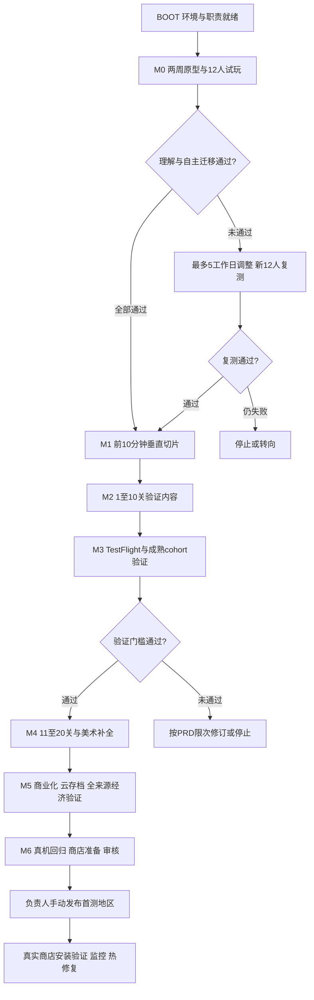

# 从分工到 App Store 的执行总册

版本：2026-10-11。本文将 PRD 转成可交接的生产流程。**当前执行阶段为 M0；后续阶段均以验证通过为前提。** 这份计划没有声称客户端、美术素材、真人试玩或上架已完成，实时状态见 [状态板](status.md)。

## 入口与事实来源

| 想做什么 | 入口 |
|---|---|
| 让 Claude 开工 | [可直接转交的指令](claude-handoff.md)、根目录 [CLAUDE.md](../../CLAUDE.md) |
| 看下一步任务 | [开发清单](backlog.md)、[当前状态](status.md) |
| 找产品规则 | [PRD](../prd/README.md)，当前范围以 [第 0 章](../prd/00-two-week-prototype.md) 为准 |
| 找美术制作及导入要求 | [美术规范](../art/README.md)、[素材清单](../art/asset-manifest.md) |
| 知道如何真正测完 | [测试计划](../qa/test-plan.md)、[记录模板](../qa/test-run-template.md) |
| 准备 TestFlight 与商店发布 | [上线手册](../release/app-store.md) |

规则冲突处理：阶段范围看第 0/12 章；玩法与经济看对应 PRD 章节和可复算结果；制作方式看本册；完成状态看带证据的状态板。发现冲突提交修订，不同时保留两套生效规则。对现阶段以外的建议记入 backlog，不能借机扩张 M0。

## 分工与交付责任

| 工作 | 主责 | 协作与验收 | 必交付物 |
|---|---|---|---|
| 玩法、数值、范围和实验设计 | Codex | Claude 反馈可实现性；负责人决定阶段取舍 | PRD 变更、固定配置、例子、验收条件 |
| 风格、角色/场景/UI/特效素材、商店视觉 | Codex | Claude 定接口并导入；负责人确认关键方向 | 概念与定稿、导出文件、来源记录、导入验收单 |
| 工程架构、客户端、程序动画、平台集成 | Claude | Codex 看体验与表现；负责人实际验收 | 源码 PR、可重现构建、可安装 build、变更说明 |
| 自动化、性能测量、崩溃定位 | Claude | 实机由负责人或指定测试员提供/操作 | 命令、原始日志、机型/OS、问题修复及回归证据 |
| 12 人试玩与后续留存实验 | Codex 设计和分析 | 负责人招募/主持或安排测试员；Claude 提供安装和日志支持 | 协议、去标识化逐人记录、分母、录像索引、决策报告 |
| Apple 账号、合同、银行税务、市场与预算 | 负责人 | Claude 提供配置说明，Codex 准备商店文案/视觉 | 资料就绪状态、授权角色、地区及预算决定 |
| TestFlight 上传与提审技术包 | Claude | 负责人提供账号访问并处理平台操作；Codex 验商店材料 | build、测试摘要、隐私核对、审核说明、可提交版本 |
| 最终放行、手动发布、扩大投放 | 负责人 | Codex 提供产品结论；Claude 提供技术结论 | 对具体 build/配置/地区的发布记录 |

AI 不能替代真人试玩或未连接设备上的实际操作。需要人工操作的步骤由 Claude 给出可复现步骤和期望，由实际执行人填写结果；Codex 按证据复核。角色指责任，不代表已安排持续运行的自动代理。

## 阶段路线与闸门

| 阶段 | 开工条件 | 完成依据 | 之后允许做什么 |
|---|---|---|---|
| BOOT | 交接文档可读 | 引擎 ADR、环境清单、真机空壳运行；缺设备则只完成可独立部分 | M0 闭环与必要占位美术 |
| M0 | 第 0 章范围冻结 | 10 种子多解预检；12 名新用户；四项门槛及有效性全部通过 | M1；未通过按第 0 章调整/停止 |
| M1 | M0 决策报告通过 | 正式 1–7 关及教程补助/存档正常；E-1 另招 12 人固定状态验证通过 | M2 经济与内容扩展 |
| M2 | M1 验收通过 | 正式经济跑完 1–10 关、无不可恢复阻塞；模拟与客户端差异解释完毕 | M3 外部发包 |
| M3 | 功能/日志/隐私准备就绪 | 300–1,000 安装的完整观察窗；PRD 11.6 全套短内容指标；无崩溃会话 ≥99.5% | M4；D7 只描述，不据短内容版宣称达标 |
| M4 | M3 数据评审通过 | 1–20 关、4 Boss、3 符文、正式资源导入；免费路径可完成 | M5 商业化验证 |
| M5 | M4 闭环稳定 | 所有支付/广告/云存档关键用例通过；全来源经济分组报告与可接受差异冻结 | M6 发布候选版 |
| M6 | 关键缺陷为零、上线材料完整 | 同一 RC 的回归和审核通过；负责人确认 build、配置、市场和价格 | 首测地区发布 |
| 发布后 | 商店已可下载 | 商店下载包实测、监控及热修复演练；内容充分时再判 D7 | 达标才扩市场/预算或做 P1 |

M0 通过数值只在 [0.5](../prd/00-two-week-prototype.md#05-招募记录与指标) 维护；后续体验、留存门槛只在 [11.6](../prd/11-data-validation.md#116-继续调整停止的条件) 维护。本册不另设一套更宽松标准。M6 的“可发布”是技术及产品放行；上线后的 D7 和付费结论需要新的实际观察，不能提前填通过。

## 时间与资源安排

- **M0 是 10 个工作日目标**，按第 0 章执行；账号/机器未就绪、招募不足、审核等待均单列，不假定两周自然日能完成。
- PRD 的完整 P0 **17.5–25.5 程序人周、约 79 美术日**是原人类团队工作量估算，不是 Claude/Codex 的交付速度保证。此前 12 周验证版、再 6–8 周首测版仅作基线。
- Claude 在 BOOT-01、M0 结束及每阶段开始重估剩余工作；Codex 在首批资源真机导入后重估美术产能。报乐观/正常/受阻三种完成窗口和假设。
- M3 发包后至少再留 1 周观察，并等各指标完整窗口及足够样本；Apple 审核时长不作为可控工期。M4 不在等待数据期间自动开工。
- 负责人提前落实 Mac 构建环境、测试 iPhone、开发者账号，以及外测招募。音频授权/外包、SDK 服务及买量费用均先给预算方案，不默认购买或投放。

## 每日与每个 PR 的工作方式

1. Claude 从状态板领取一个可验收任务，记录依赖及预计交付；把美术需求按稳定 ID 提给 Codex，由负责人转交。
2. Codex 交付该批规范/素材，Claude 先用占位推进规则层，再按清单导入；用真机截图/视频回传视觉问题。
3. Claude 完成代码、自测、相关回归和实际构建。测试员完成需人工的设备用例，保留原始结果。
4. PR 写清具体前后行为、涉及任务 ID、测试命令与结果、设备证据、未测项、风险、是否改配置/存档；不要只贴“已完成”。
5. Codex 检查规则、体验、美术与实验有效性；负责人或指定维护者合并，并在阶段结束记录继续/调整/停止决定。

建议开发分支 `claude/<任务ID>-<简述>`，美术分支 `codex/art-<批次>`；若当前文档 PR 尚未合并，先在其最新 head 上建实现分支，并把 PR 基线写清。合并后再更新 base，不复制一份过期 PRD。不要混入工作区已有的无关改动。

## 完成定义

任务 DONE 必须同时具备：范围内行为实现、相关自动检查通过、该阶段要求的真实设备证据、缺陷与未测项明确、使用说明和状态已更新。发布关口的关键缺陷不能以“后面补”关闭。资料不足填 `NOT RUN` 或 `BLOCKED`，不是 `PASS`。
